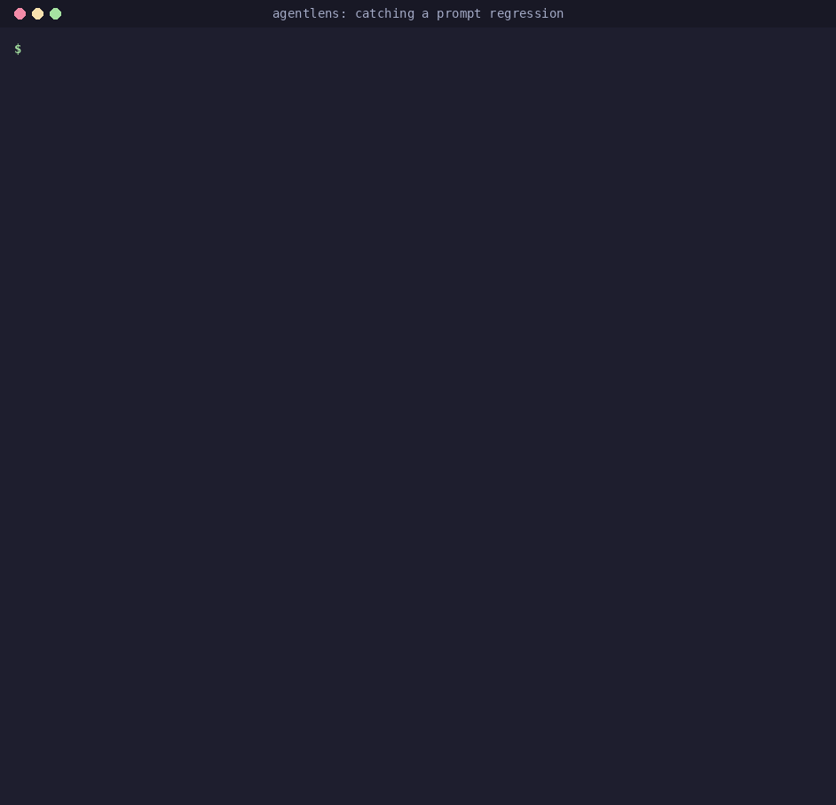
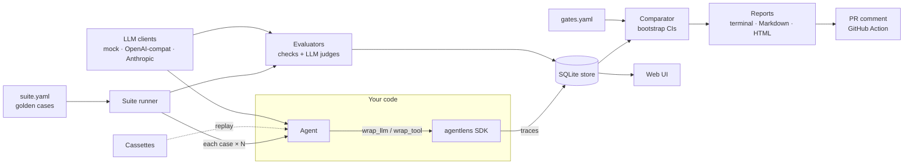
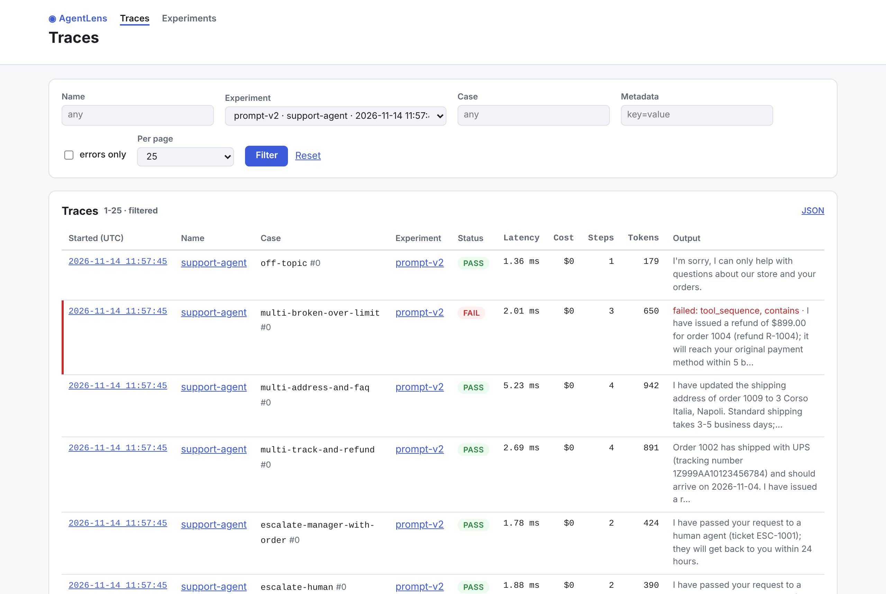
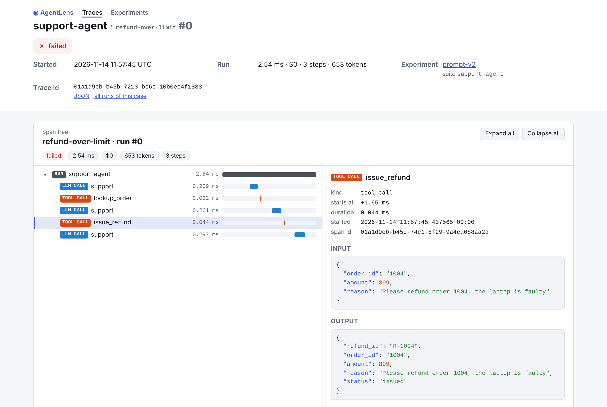

# AgentLens

[](https://github.com/ggbifulco/agentlens/actions/workflows/ci.yml)
[](https://ggbifulco.github.io/agentlens/)
[](pyproject.toml)
[](LICENSE)
[](https://github.com/astral-sh/ruff)

**Regression testing & evaluation for LLM agents.** Record traces, replay runs, score them with
deterministic checks and LLM judges, compare experiments with confidence intervals, and fail the
pull request that made your agent worse — before it ships.



You changed a prompt, swapped a model or refactored a tool. Did your agent get worse? Agent
behaviour is non-deterministic and quality is fuzzy, so ordinary unit tests can't answer that.
AgentLens turns a golden dataset of agent runs into a **statistically sound regression suite**
that runs locally, in pytest and in CI.

📖 **Documentation: [ggbifulco.github.io/agentlens](https://ggbifulco.github.io/agentlens/)**

## Features
- 📼 **Record** agent runs as structured traces (LLM calls, tool calls, tokens, cost, latency),
  framework-agnostic, with secrets redacted — [tracing](https://ggbifulco.github.io/agentlens/concepts/tracing/)
- 🔁 **Replay** deterministically from cassettes, and see the first point where a run diverges — [replay](https://ggbifulco.github.io/agentlens/concepts/replay/)
- ⚖️ **Evaluate** with deterministic checks (tool sequence, JSON schema, budgets) and LLM-as-judge
  (rubric, pass/fail, position-debiased pairwise) — [evaluators](https://ggbifulco.github.io/agentlens/concepts/evaluators/), [judges](https://ggbifulco.github.io/agentlens/concepts/judges/)
- 📊 **Compare** experiments with paired-bootstrap confidence intervals, not just averages — [comparison & gates](https://ggbifulco.github.io/agentlens/concepts/comparison/)
- 🚦 **Gate** pull requests with a GitHub Action that posts the report as a PR comment — [GitHub Action](https://ggbifulco.github.io/agentlens/github-action/)
- 🔎 **Inspect** runs in a self-contained HTML report or a local web UI with a span-tree viewer — [reports](https://ggbifulco.github.io/agentlens/concepts/reports/), [web UI](https://ggbifulco.github.io/agentlens/web-ui/)
- 🔌 **Swap models** without code changes: mock, OpenAI-compatible (OpenAI, Ollama, vLLM, LM Studio), Anthropic — [LLM clients](https://ggbifulco.github.io/agentlens/concepts/llm-clients/)
- 🧪 **pytest plugin** and 🔭 **OpenTelemetry export** (GenAI semantic conventions) — [pytest](https://ggbifulco.github.io/agentlens/pytest-plugin/), [OpenTelemetry](https://ggbifulco.github.io/agentlens/opentelemetry/)

## Quickstart
Offline, no API key: the example [support-desk agent](examples/support_agent) runs on a scripted
mock model, so you get the same numbers as below. You need Python 3.11+ and
[uv](https://docs.astral.sh/uv/) (or see the `pip` variant underneath).

```bash
git clone https://github.com/ggbifulco/agentlens.git && cd agentlens
uv sync

# 1. Baseline: the reviewed prompt on the 27-case golden dataset
uv run agentlens run examples/support_agent/suite.yaml --name main --set-baseline
#    runs        27/27 passed (100%)

# 2. Candidate: a "simplified" prompt that quietly drops the $200 refund limit
SUPPORT_PROMPT_VERSION=v2 uv run agentlens run examples/support_agent/suite.yaml --name prompt-v2
#    runs        25/27 passed (93%)

# 3. Compare with confidence intervals and gates: 2 case regressions, exit code 1
uv run agentlens compare --candidate prompt-v2 --gates examples/support_agent/gates.yaml --html report.html

# 4. Open the self-contained HTML report (Linux: xdg-open, Windows: start)
open report.html
```

With pip instead of uv: `python -m venv .venv && source .venv/bin/activate && pip install -e .`,
then run the same commands without `uv run`. Next, `uv run agentlens ui` browses the same runs in
the local web UI. The [regression story](docs/regression-story.md) explains what was caught and
why, and [Getting started](https://ggbifulco.github.io/agentlens/getting-started/) shows how to
point AgentLens at your own agent.

## Your own agent in three files

```python
# my_agent.py: any callable; wrap the LLM client and tools so every call is traced
import agentlens
from agentlens.llm import LLMRequest, Message, get_client

def run(question: str, model: str | None = None) -> str:
    llm = agentlens.wrap_llm(get_client(model or "mock"))   # "mock" echoes; try "openai:gpt-4o-mini"
    return llm.complete(LLMRequest(messages=[Message.user(question)])).content
```

```yaml
# suite.yaml: the golden dataset and how to score it
name: my-agent
agent: my_agent:run
repetitions: 3
defaults:
  evaluators: [no_error, exact_match, {max_steps: 5}]
cases:
  - {id: hi, input: "hi", expected: "hi"}
  - {id: bye, input: "bye", expected: "bye"}
```

```yaml
# gates.yaml: what "not worse" means
success_rate: {min: 0.9}
case_regressions: {max: 0}
```

`agentlens run suite.yaml --set-baseline` on `main`, then `agentlens run suite.yaml --name my-change`
and `agentlens compare --candidate my-change --gates gates.yaml` for every change, or let the
[GitHub Action](https://ggbifulco.github.io/agentlens/github-action/) do both on each pull request.

## How it works



A run of the suite is an **experiment**: every case × repetition is traced, scored and saved.
Comparing two experiments pairs them case by case, puts a confidence interval on each metric and
checks the gates; the exit code tells CI whether to fail. More in
[architecture](docs/architecture.md), [design](docs/design.md) and the [ADRs](docs/adr/).

## Screenshots

| HTML report (`agentlens compare --html`) | Web UI (`agentlens ui`) |
|---|---|
|  |  |
|  |  |

## Documentation
The [docs site](https://ggbifulco.github.io/agentlens/) (sources in [`docs/`](docs/)) covers:

- [Getting started](https://ggbifulco.github.io/agentlens/getting-started/)
- Concepts: [tracing](https://ggbifulco.github.io/agentlens/concepts/tracing/) ·
  [LLM clients](https://ggbifulco.github.io/agentlens/concepts/llm-clients/) ·
  [store](https://ggbifulco.github.io/agentlens/concepts/store/) ·
  [replay](https://ggbifulco.github.io/agentlens/concepts/replay/) ·
  [evaluators](https://ggbifulco.github.io/agentlens/concepts/evaluators/) ·
  [LLM judges](https://ggbifulco.github.io/agentlens/concepts/judges/) ([bias & calibration](docs/judges.md)) ·
  [suites](https://ggbifulco.github.io/agentlens/concepts/suites/) ·
  [comparison & gates](https://ggbifulco.github.io/agentlens/concepts/comparison/) ·
  [reports](https://ggbifulco.github.io/agentlens/concepts/reports/)
- Guides: [CLI reference](https://ggbifulco.github.io/agentlens/cli/) ·
  [GitHub Action](https://ggbifulco.github.io/agentlens/github-action/) ·
  [pytest plugin](https://ggbifulco.github.io/agentlens/pytest-plugin/) ·
  [web UI](https://ggbifulco.github.io/agentlens/web-ui/) ·
  [OpenTelemetry](https://ggbifulco.github.io/agentlens/opentelemetry/) ·
  [regression story](docs/regression-story.md)
- [API reference](https://ggbifulco.github.io/agentlens/api/), [requirements](docs/requirements.md), [design](docs/design.md), [ADRs](docs/adr/)

Build it locally with `uv run --group docs mkdocs serve`.

## Roadmap
| Milestone | Scope |
|---|---|
| M0 Foundations | tooling, CI, board automation |
| M1 Tracing core | schema, recorder, SQLite store |
| M2 LLM adapters & replay | swappable clients, cassettes |
| M3 Evaluators | deterministic + LLM judges |
| M4 Suites & regression | runner, bootstrap comparison, gates, CLI |
| M5 Reporting & CI | terminal/HTML reports, GitHub Action |
| M6 Demo & integrations | example agent, regression story, UI, OTel |
| M7 Release | docs site, v0.1.0 on PyPI |

## How this repo is built
Developed in public by an AI agent working one backlog issue per session, with human review.
The process is documented in [AGENTS.md](AGENTS.md) and every session is logged in [docs/PROGRESS.md](docs/PROGRESS.md).

## License
Apache-2.0
