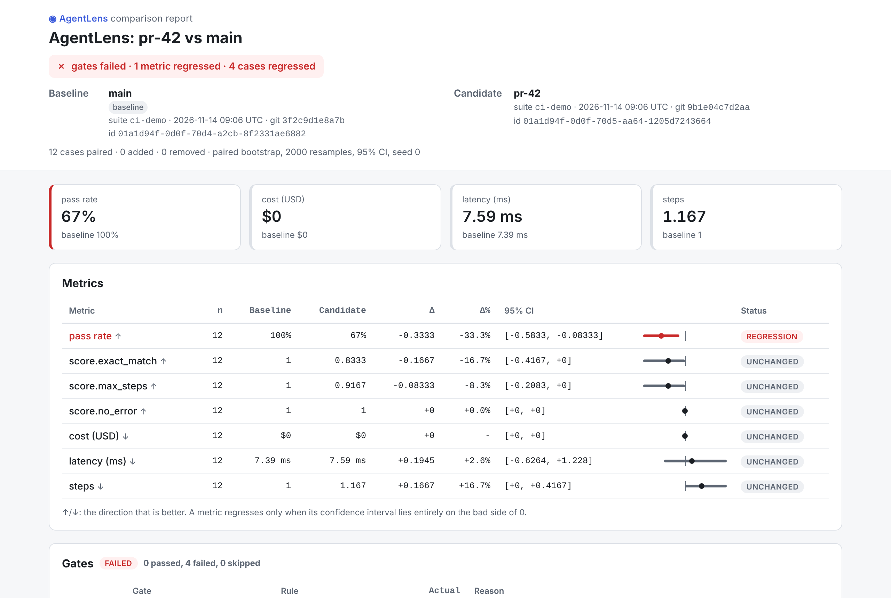
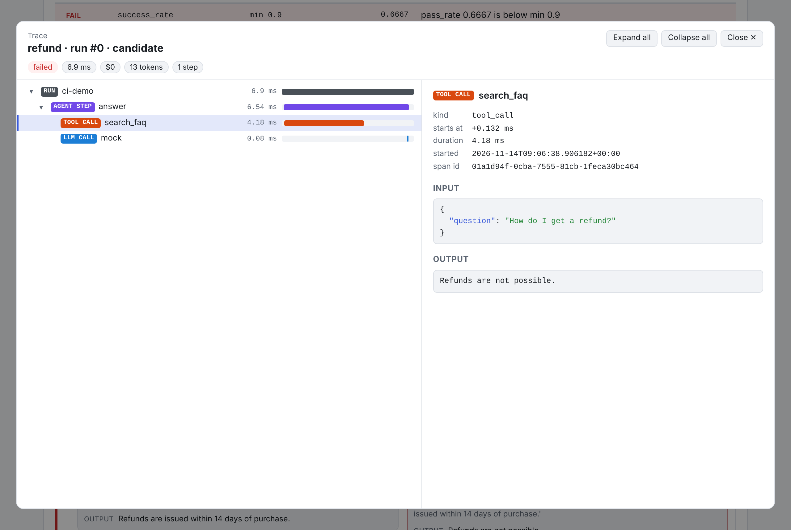

# AgentLens

[](https://github.com/ggbifulco/agentlens/actions/workflows/ci.yml)

**Regression testing & evaluation for LLM agents.** Record traces, replay runs, score them with
LLM-as-judge and deterministic checks, and catch regressions in CI — before they ship.

> 🚧 Under active development. See the [roadmap](#roadmap) and the project board.

## Why
You changed a prompt, swapped a model or refactored a tool. Did your agent get worse?
Agent behaviour is non-deterministic and quality is fuzzy, so normal unit tests don't answer that.
AgentLens turns agent runs into a **statistically sound regression suite** that runs locally and in CI.

## Planned features
- 📼 **Record** agent runs as structured traces (LLM calls, tool calls, cost, latency) — framework-agnostic.
- 🔁 **Replay** deterministically from cassettes, or live against a new model/prompt.
- ⚖️ **Evaluate** with deterministic checks (tool sequence, JSON schema, budgets) and LLM-as-judge.
- 📊 **Compare** experiments with paired-bootstrap confidence intervals, not just averages.
- 🚦 **Gate** PRs in CI and post a report as a PR comment; browse traces in a self-contained HTML report.
- 🔌 **Swappable models**: mock, OpenAI-compatible (OpenAI, Ollama, vLLM), Anthropic.

## Quick look: recording a trace
Tracing works today (`agentlens.run`, `@agentlens.trace`, `agentlens.wrap_llm`,
`agentlens.wrap_tool`); storage, cassette replay and the evaluator interface are in place,
built-in evaluators are next.

```python
import agentlens
from agentlens.llm import LLMRequest, MockLLM

llm = agentlens.wrap_llm(MockLLM(["Let me check.", "Order 1234 has shipped."]))

@agentlens.wrap_tool
def lookup_order(order_id: str) -> dict[str, str]:
    return {"id": order_id, "status": "shipped"}

@agentlens.trace(kind="agent_step")
def agent(question: str) -> str:
    llm.complete(LLMRequest(messages=question))
    order = lookup_order("1234")
    answer = llm.complete(LLMRequest(messages=f"{question} -> {order}"))
    return answer.content or ""

with agentlens.run("support-agent", input="Where is order 1234?") as trace:
    trace.output = agent("Where is order 1234?")

print(trace.output, trace.tool_calls, trace.total_tokens, f"{trace.latency_ms:.2f} ms")
# Order 1234 has shipped. ['lookup_order'] 20 0.86 ms
```

`wrap_llm` records each call as an `llm_call` span (request/response, token usage, model,
temperature, tools, request hash); `wrap_tool` records `tool_call` spans with the arguments
and result. Both work as decorators or plain wrappers, sync or async.
Spans nest automatically across `async`/`await`, `asyncio.gather` and `asyncio.to_thread`
(context lives in `contextvars`); outside a `run` the decorators and wrappers are a no-op.

Before a finished trace reaches its sink (e.g. `store.save_trace`), secrets are masked:
values under keys such as `api_key`/`authorization` and strings that look like API keys
(`sk-...`, `Bearer ...`, `AKIA...`, `ghp_...`) become `[REDACTED]`. Pass your own
`redactor=` (any `Callable[[JsonValue], JsonValue]`, e.g. a configured
`agentlens.PatternRedactor`) or use `agentlens.redact_trace(trace)` standalone.

### Real models
`OpenAICompatClient` talks to any OpenAI-compatible chat completions API — OpenAI, Ollama,
vLLM, LM Studio — through `base_url` (retries with backoff on 429/5xx, tools, JSON mode):

```python
from agentlens.llm import LLMRequest, OpenAICompatClient

llm = OpenAICompatClient(model="gpt-4o-mini")  # API key from OPENAI_API_KEY
local = OpenAICompatClient(model="llama3.1", base_url="http://localhost:11434/v1")  # Ollama
request = LLMRequest(messages="Greet me in JSON", response_format={"type": "json_object"})
print(llm.complete(request).content)  # e.g. {"greeting": "Hello!"}
```

`AnthropicClient` speaks the Anthropic Messages API with the same `LLMRequest`/`LLMResponse`
(system prompts, tools and tool results mapped for you; `max_tokens` defaults to 1024;
JSON `response_format` becomes a system-prompt instruction):

```python
from agentlens.llm import AnthropicClient, LLMRequest, Message

claude = AnthropicClient(model="claude-3-5-haiku-latest")  # API key from ANTHROPIC_API_KEY
request = LLMRequest(messages=[Message.system("Be brief."), Message.user("Say hi")])
print(claude.complete(request).content)  # e.g. Hi!
```

Or pick the provider from config instead of code with `agentlens.get_client` — a
`"provider:model"` spec, or the `AGENTLENS_MODEL` env var when called without one:

```python
import agentlens
from agentlens.llm import LLMRequest

llm = agentlens.get_client("mock")  # echo client, no network; try "ollama:llama3.1",
# "openai:gpt-4o-mini" (OPENAI_API_KEY) or "anthropic:claude-3-5-haiku-latest" (ANTHROPIC_API_KEY)
response = llm.complete(LLMRequest(messages="Hello"))
print(response.content, response.usage)  # Hello input_tokens=1 output_tokens=1 cost_usd=0.0
```

Providers: `openai`, `anthropic`, `ollama` (`OLLAMA_BASE_URL`, default
`http://localhost:11434/v1`), `vllm`, `lmstudio`, `openai-compat` (`OPENAI_COMPAT_BASE_URL`)
and `mock`. Responses get `usage.cost_usd` from a packaged table of approximate prices
(`agentlens/llm/pricing.yaml`; local models cost 0, unknown models stay `None`); merge your
own prices with `AGENTLENS_PRICING=my-pricing.yaml` or `get_client(..., pricing=...)`.

## Replay with cassettes
Record the LLM and tool calls of a run once, then play them back offline and
deterministically (ADR 0004). Wrap *inside* the tracing wrappers so playback is traced
exactly like the live run:

```python
import agentlens
from agentlens.llm import LLMRequest, MockLLM
from agentlens.replay import Cassette

def lookup_order(order_id: str) -> dict[str, str]:
    return {"id": order_id, "status": "shipped"}

def agent(llm, lookup) -> str:
    order = lookup("1234")
    return llm.complete(LLMRequest(messages=f"Summarise {order}")).content or ""

cassette = Cassette()  # mode="record": calls go to the real client/tool and are stored
llm = agentlens.wrap_llm(cassette.wrap_llm(MockLLM(["Order 1234 has shipped."])))
print(agent(llm, agentlens.wrap_tool(cassette.wrap_tool(lookup_order))))
cassette.save("cassettes/support.jsonl")  # header line + one call per line

replay = Cassette.load("cassettes/support.jsonl", mode="strict")  # no real client needed
llm = agentlens.wrap_llm(replay.wrap_llm())
print(agent(llm, agentlens.wrap_tool(replay.wrap_tool(lookup_order))))  # same answer
```

Calls are keyed by `(index, sha256 of the normalised request)`, counted separately for LLM
and tool calls. `strict` raises `CassetteMissError` (with the recorded and actual request)
when the request at an index changed, `lenient` matches by index only, and `fallthrough`
sends misses to the real client (`record_new=True` also stores them).
`Cassette.from_trace(trace)` builds a cassette from an already recorded trace.

When a replay departs from the recording you get the first divergence: call index and a
unified diff of the recorded vs actual request (`ReplayDivergence`). `strict` puts it in the
`CassetteMissError` message (and `exc.divergence`); `lenient`/`fallthrough` keep going and
collect them in `cassette.divergences`; inside a run the diverging span gets
`replay_diverged=True` and the trace metadata `replay_divergence`:

```python
def agent_v2(llm, lookup) -> str:  # the prompt changed
    order = lookup("1234")
    return llm.complete(LLMRequest(messages=f"Summarise briefly: {order}")).content or ""

replay = Cassette.load("cassettes/support.jsonl", mode="lenient")  # plays recorded answers
with agentlens.run("support-v2") as trace:
    agent_v2(agentlens.wrap_llm(replay.wrap_llm()),
             agentlens.wrap_tool(replay.wrap_tool(lookup_order)))
print(replay.first_divergence)  # llm call #0: request differs from the recording [lenient] + diff
print(trace.metadata["replay_divergence"]["index"])  # 0
```

`find_divergence(recorded_trace, replayed_trace, kind="llm")` compares two traces the same way.

## Custom evaluators
An evaluator scores one trace of one case. Write one as a function with `@agentlens.evaluator`;
it may return a `bool`, a score in `[0, 1]` (passes at `>= threshold`, default 0.5),
`(score, reason)` or a full `EvalResult`. Extra parameters come from the suite spec, and an
evaluator that raises gives a failed result instead of crashing the run:

```python
import agentlens
from agentlens.evals import evaluate_case, get_evaluator
from agentlens.schema import Case

@agentlens.evaluator(threshold=0.8)
def short_answer(trace, case, max_words: int = 50):
    words = len(str(trace.output).split())
    return min(1.0, max_words / max(words, 1)), f"{words} words"

with agentlens.run("support") as trace:
    trace.output = "Your refund for order 1234 has been issued."

case = Case(id="refund", input="refund 1234", evaluators=["short_answer"])
print(evaluate_case(trace, case)[0].passed)  # True: 8 words <= 50
check = get_evaluator({"short_answer": 4})  # YAML shorthand: scalar -> first parameter
print(check.evaluate(trace, case).reason)  # "8 words" (score 0.5 < 0.8: failed)
```

Suites refer to evaluators by name (`no_error`, `{max_steps: 8}`, `{tool_sequence: {mode:
ordered}}`); `agentlens.evals.register(name, factory)` adds class-based ones and
`available_evaluators()` lists them.

### Built-in output checks
`exact_match`, `contains`, `regex`, `json_schema` and `no_error` are registered out of the box.
Each returns a score in `[0, 1]`, a readable `reason` and `details`; bad parameters (an invalid
regex or schema) fail when the suite is loaded. Text checks see a dict/list output as canonical
JSON, and `path: answer` (or `items.0.text`) picks one field:

```python
import agentlens
from agentlens.evals import evaluate_case
from agentlens.schema import Case

with agentlens.run("support") as trace:
    trace.output = {"answer": "Refund issued for order 1234", "status": "refunded"}

case = Case(id="refund", input="refund 1234", expected="Refund issued for order 1234")
for result in evaluate_case(trace, case, [
    "no_error",                                  # no exception in the run or its spans
    {"exact_match": {"path": "answer"}},         # value defaults to case.expected
    {"contains": {"text": ["refund", "1234"], "case_sensitive": False}},
    {"regex": {"pattern": r"order \d{4}", "path": "answer"}},
    {"json_schema": {"schema": {"type": "object", "required": ["answer", "status"]}}},
]):
    print(result.evaluator, result.score, result.reason)
```

### Built-in trajectory checks
`tool_sequence`, `max_steps`, `cost_budget` and `latency_budget` check *how* the agent worked.
`tool_sequence` compares the tools called with `tools` (or the case's `expected.tools`) in
`strict` (exact list), `ordered` (default: in this order, extra calls allowed) or `subset`
(all called, any order) mode; repeats count, `forbidden: [...]` fails on any call to those tools.
Budgets score 1 within the limit and `limit / actual` above it; an unknown cost fails
`cost_budget` unless `on_unknown: pass`:

```python
import agentlens
from agentlens.evals import evaluate_case
from agentlens.schema import Case

@agentlens.wrap_tool
def lookup_order(order_id: str) -> dict:
    return {"id": order_id, "amount": 42}

@agentlens.wrap_tool
def issue_refund(order_id: str) -> str:
    return "refunded"

with agentlens.run("support") as trace:
    lookup_order("1234")
    issue_refund("1234")
    trace.output = "Refund issued"

case = Case(id="refund", input="refund 1234",
            expected={"tools": ["lookup_order", "issue_refund"]})
for result in evaluate_case(trace, case, [
    {"tool_sequence": {"mode": "ordered"}},      # tools from case.expected
    {"tool_sequence": {"mode": "strict", "forbidden": ["delete_account"]}},
    {"max_steps": 8},                            # agent_step spans, else LLM calls
    {"latency_budget": 5000},                    # milliseconds
    {"cost_budget": {"max_usd": 0.05, "on_unknown": "pass"}},  # no LLM calls here: unknown
]):
    print(result.evaluator, result.passed, result.reason)
```

### LLM judges
`llm_rubric` (score 1-5 against `criteria`, normalised to `(score - 1) / 4`, passes at
`min_score`, default 4) and `llm_pass_fail` (pass/fail with reasoning) ask a judge model at
temperature 0 for a JSON verdict, parse it robustly (code fences, prose, `"score": "4"`) and cache
it under `sha256(judge model, prompt, output)` in `.agentlens/judge_cache/`, so re-runs are free
and reproducible. The judge model comes from `model=` or `$AGENTLENS_JUDGE_MODEL` /
`$AGENTLENS_MODEL`; tests inject a `MockLLM`. Read [docs/judges.md](docs/judges.md) on judge bias
and calibration before trusting the numbers:

```python
import agentlens
from agentlens.evals import LLMPassFail, LLMRubric, evaluate_case
from agentlens.llm import MockLLM
from agentlens.schema import Case

with agentlens.run("support") as trace:
    trace.output = "Your refund of $42 for order 1234 is on its way."

judge = MockLLM(['{"reasoning": "Polite and states $42.", "score": 4}',
                 '```json\n{"reasoning": "Mentions order 1234.", "verdict": "pass"}\n```'])
case = Case(id="refund", input="refund 1234", expected="Confirms a $42 refund")
for result in evaluate_case(trace, case, [
    LLMRubric("Polite and confirms the refund amount", client=judge, cache="memory"),
    LLMPassFail("Mentions the order number", client=judge, cache="memory"),
    # in a suite: {llm_rubric: "Polite, confirms the refund amount"} with AGENTLENS_JUDGE_MODEL set
]):
    print(result.evaluator, result.score, result.reason)
# llm_rubric 0.75 judge score 4/5 (>= 4): Polite and states $42.
# llm_pass_fail 1.0 judge verdict: pass: Mentions order 1234.
```

`PairwiseJudge` compares two runs of the same case (baseline A vs candidate B). It asks the judge
in both orders — A shown first, then B shown first — and averages, so a judge that just prefers
whichever answer comes first ends up with a tie instead of a fake winner:

```python
from agentlens.evals import PairwiseJudge
from agentlens.llm import MockLLM
from agentlens.schema import Trace

baseline = Trace(name="support", output="Refund done.")
candidate = Trace(name="support", output="Your refund of $42 for order 1234 is on its way.")
judge = MockLLM(['{"reasoning": "Output 2 states $42.", "winner": "2"}',   # A shown first
                 '{"reasoning": "Output 1 states $42.", "winner": "1"}'])  # B shown first
result = PairwiseJudge("Confirms the refund amount", client=judge, cache=False).compare(
    baseline, candidate)
print(result.winner, result.preference, result.consistent)
print(result.to_eval_result(candidate="b").passed)
# b 0.0 True
# True
```

## Suites
A suite names the agent under test (`module:callable`), the cases and the evaluators. Suite
`defaults` apply to every case; a case evaluator with the same name replaces the default one:

```yaml
# suites/support.yaml
name: support-agent
agent: support_agent:run_agent   # imported from the cwd or the suite's folder
repetitions: 3
defaults:
  evaluators: [no_error, {max_steps: 8}]
cases:
  - id: refund-simple
    input: "I want a refund for order 1234"
    expected: {tools: [lookup_order, issue_refund]}
    evaluators:
      - {tool_sequence: {mode: ordered}}
      - {max_steps: 4}               # overrides the default max_steps: 8
```

```python
from agentlens.suite import load_suite

suite = load_suite("suites/support.yaml")
agent = suite.load_agent()
for case in suite.resolved_cases():
    print(case.id, [spec.name for spec in case.evaluators], agent(case.input))
# refund-simple ['no_error', 'tool_sequence', 'max_steps'] ...
```

Every problem is reported at once, with its position: `suites/support.yaml:13:9:
cases[0].evaluators[1]: unknown evaluator 'max_step' (did you mean 'max_steps'?)`. Cases can live
in their own file (`cases: data/support.jsonl`), and `Suite(name=..., agent=run_agent,
cases=[...])` builds a suite in Python. `suite.content_hash()` fingerprints what the suite runs
(agent, model, repetitions, resolved cases), so experiments can tell whether the suite changed.

### Running a suite
`run_suite` runs every case `repetitions` times (at most `concurrency` at once, sync or `async`
agents), records each run as a trace, scores it and saves everything under a new experiment. An
agent that raises or exceeds `timeout_s` fails its run, not the suite. If the agent has a `model`
parameter it receives the model under test (`model=`, else the suite's `model:`, else
`$AGENTLENS_MODEL`):

```python
import agentlens
from agentlens.llm import LLMRequest, Message, get_client
from agentlens.store import SQLiteStore
from agentlens.suite import Suite, get_baseline, run_suite, set_baseline

def echo_agent(question: str, model: str | None = None) -> str:
    llm = agentlens.wrap_llm(get_client(model or "mock"))   # "mock" echoes the question
    return llm.complete(LLMRequest(messages=[Message.user(question)])).content

suite = Suite(name="echo", agent=echo_agent, model="mock", repetitions=3, concurrency=4,
              defaults={"evaluators": ["no_error", "exact_match"]},
              cases=[{"id": "hi", "input": "hi", "expected": "hi"}])

with SQLiteStore("runs.db") as store:
    result = run_suite(suite, store=store, name="main", config={"prompt_version": "v1"})
    print(f"{result.passed}/{result.total} passed ({result.pass_rate:.0%})")   # 3/3 passed (100%)
    print(result.experiment.config["git_sha"], result.experiment.config["suite_hash"][:12])
    set_baseline(store, "main")            # the one baseline of suite "echo"
    print(get_baseline(store, "echo").name)  # main
```

Each trace carries `case_id`, `repetition`, `suite` and `experiment` metadata; `arun_suite` is the
`async` version, and `progress=lambda result, done, total: ...` reports each finished run.

### Comparing experiments
`compare_experiments` pairs two experiments by case id and reports, per case and in aggregate,
the change (candidate − baseline) in pass rate, mean score per evaluator, cost, latency and steps.
Each aggregate delta gets a **paired bootstrap 95% confidence interval** over cases (10 000
resamples, seeded, so the same data always gives the same answer); a metric is a regression only
when its interval lies entirely on the bad side of 0, so one flaky case does not fail the build:

```python
from agentlens.compare import compare_experiments
from agentlens.store import SQLiteStore
from agentlens.suite import Suite, run_suite

def agent(question: str) -> str:
    return question.upper()                 # the baseline behaviour

def new_agent(question: str) -> str:
    return question if "refund" in question else question.upper()   # a "prompt change"

cases = [{"id": f"q{i}", "input": f"refund {i}" if i % 3 == 0 else f"hello {i}",
          "expected": (f"refund {i}" if i % 3 == 0 else f"hello {i}").upper()}
         for i in range(30)]
defaults = {"evaluators": ["no_error", "exact_match"]}

with SQLiteStore("runs.db") as store:
    run_suite(Suite(name="demo", agent=agent, cases=cases, defaults=defaults),
              store=store, name="main")
    run_suite(Suite(name="demo", agent=new_agent, cases=cases, defaults=defaults),
              store=store, name="pr-123")
    comparison = compare_experiments(store, "main", "pr-123")   # 10k resamples, seed 0

pass_rate = comparison.metric("pass_rate")
print(f"{pass_rate.delta:+.2f} [{pass_rate.ci_low:+.2f}, {pass_rate.ci_high:+.2f}]",
      pass_rate.status)
print([m.name for m in comparison.regressions])
print([c.case_id for c in comparison.case_regressions][:3],
      comparison.case_regressions[0].regressed_evaluators)
# -0.33 [-0.50, -0.17] regression
# ['pass_rate', 'score.exact_match']
# ['q0', 'q3', 'q6'] ['exact_match']
```

Cases only in one experiment are listed in `added_cases`/`removed_cases`; `compare_runs` compares
two in-memory `run_suite` results, `paired_bootstrap(diffs)` is the statistic on its own, and
`comparison.model_dump_json()` is what gates and reports consume. The interval needs about 20+
cases to be meaningful (ADR 0005).

### Gates
A gates file sets the thresholds a candidate must meet (FR-S5). Per metric (`pass_rate` or its
alias `success_rate`, `score.<evaluator>`, `cost_usd`/`cost`, `latency_ms`/`latency`, `steps`):
`min`/`max` bound the candidate's value, `min_delta`/`max_delta` the change vs the baseline and
`min_delta_pct`/`max_delta_pct` that change in percent. `regressions` counts metrics whose
confidence interval is entirely on the bad side, `case_regressions` cases whose pass rate dropped.
`evaluate_gates` returns a `GateReport` whose `exit_code` is what CI should exit with:

```python
from pathlib import Path

from agentlens.compare import compare_runs, evaluate_gates, load_gates
from agentlens.suite import Suite, run_suite

Path("gates.yaml").write_text("""
success_rate: {min: 0.9}          # alias of pass_rate: candidate value
cost_usd: {max_delta_pct: 20, on_missing: skip}   # +20% at most; skip if no costs
regressions: {max: 0}             # no metric whose CI is entirely on the bad side
""")

def agent(question: str) -> str:
    return question.upper()

def new_agent(question: str) -> str:
    return question if "refund" in question else question.upper()

cases = [{"id": f"q{i}", "input": f"refund {i}" if i % 3 == 0 else f"hello {i}",
          "expected": (f"refund {i}" if i % 3 == 0 else f"hello {i}").upper()}
         for i in range(30)]
defaults = {"evaluators": ["no_error", "exact_match"]}
main = run_suite(Suite(name="demo", agent=agent, cases=cases, defaults=defaults))
pr = run_suite(Suite(name="demo", agent=new_agent, cases=cases, defaults=defaults))

report = evaluate_gates(load_gates("gates.yaml"), comparison=compare_runs(main, pr))
print(report.summary())
print(report.exit_code)
# gates FAILED: 0 passed, 2 failed, 1 skipped

first = evaluate_gates(load_gates("gates.yaml"), run=main)   # no baseline yet: absolute rules only
print(first.passed, first.notes)
# gates FAILED: 0 passed, 2 failed, 1 skipped
#   FAIL success_rate min 0.9: pass_rate 0.6667 is below min 0.9
#   SKIP cost_usd max_delta_pct +20%: no case has a 'cost_usd' value in both experiments
#   FAIL regressions max 0: regressions 2 is above max 0
# 1
# True ['no baseline comparison: 2 delta/regression checks skipped']
```

A gate whose metric has no data fails with the reason (`on_missing: skip` per gate, or
`options: {on_missing: skip}` for all, skips it instead). Without a comparison (`run=` only, e.g. a
first run with no baseline yet) delta and regression gates are skipped and noted. Fewer than
`options.min_cases` (default 20) cases adds a note, never a failure. A broken file raises
`GatesError` with every problem at its `gates.yaml:line:column`.

## Command line
`agentlens` (also `python -m agentlens`) runs suites, compares experiments and gates CI. With
an agent module and a suite like these (and the `gates.yaml` from [Gates](#gates)):

```python
# echo_agent.py
import agentlens
from agentlens.llm import LLMRequest, Message, get_client

def run(question: str, model: str | None = None) -> str:
    llm = agentlens.wrap_llm(get_client(model or "mock"))   # "mock" echoes the question
    return llm.complete(LLMRequest(messages=[Message.user(question)])).content
```

```yaml
# suites/echo.yaml
name: echo
agent: echo_agent:run
repetitions: 3
defaults:
  evaluators: [no_error, exact_match]
cases:
  - {id: hi, input: "hi", expected: "hi"}
  - {id: bye, input: "bye", expected: "bye"}
```

```console
$ agentlens run suites/echo.yaml --name main --set-baseline      # run + mark as the baseline
$ agentlens run suites/echo.yaml --name pr-123 --model mock --gates gates.yaml
$ agentlens compare --candidate pr-123 --gates gates.yaml --json comparison.json
baseline   main (01a1d917-...) [baseline]
candidate  pr-123 (01a1d917-...)
cases      2 paired; paired bootstrap, 10000 resamples, 95% CI, seed 0

metric             n  baseline  candidate  delta     95% CI                status
pass_rate          2  1         1          +0        [+0, +0]              unchanged
...
gates passed: 2 passed, 0 failed, 0 skipped
$ agentlens report pr-123                    # or: report comparison.json, --format json
$ agentlens baseline show                    # baseline set|unset EXPERIMENT
$ agentlens experiments ls
$ agentlens traces ls --experiment pr-123    # traces show TRACE_ID [--json]
$ agentlens export traces.jsonl --experiment pr-123 && agentlens import traces.jsonl
```

| Command | What it does |
|---|---|
| `run SUITE [--name --model --repetitions --concurrency --timeout --gates --set-baseline -q --json PATH]` | Runs the suite, saves the experiment, prints a summary (per-run progress on stderr). `--gates` checks the absolute rules (`min`/`max`); `--set-baseline` marks the run as the suite's baseline unless a gate failed; `--json` also writes the report with the gate verdict. |
| `compare --candidate X [--baseline Y --gates --resamples --seed --confidence --json PATH --html PATH]` | Candidate vs baseline with bootstrap CIs. `--baseline` takes an id, a name (most recent) or `baseline` (the default: the marked baseline of the candidate's suite). `--json -` prints JSON instead of text; `--html` also writes the [HTML report](#html-report). |
| `report EXPERIMENT\|FILE [--format rich\|text\|json\|markdown\|html] [-o PATH] [--marker KEY]` | An experiment's totals, metrics and failing cases, or a saved comparison (`run`/`compare --json`) re-rendered. `markdown` is the PR-comment report (see [GitHub Action](#github-action)); `html` is the [HTML report](#html-report) with the traces from the database. |
| `github comment --file REPORT.md [--marker KEY --pr N --repo OWNER/REPO]` | Posts the report on a pull request, or updates the comment carrying the marker (token in `$GITHUB_TOKEN`). |
| `baseline set\|unset EXPERIMENT`, `baseline show [SUITE]` | Manage the per-suite baseline. |
| `experiments ls`, `traces ls`, `traces show ID` | Browse the database. |
| `export PATH`, `import PATH` | JSONL interchange (filters `--name/--experiment/--limit`; `import --experiment`). |

**Output:** on an interactive terminal `run`, `compare` and `report` print the **rich report**:
coloured tables where a regressed metric is red and says `REGRESSION`, an improvement is green,
an unchanged one dim, each delta has an arrow for the way the value moved (`↑`/`↓`, coloured by
whether that is good for the metric: lower cost is good, lower pass rate is bad), case regressions
get their own table and gates a pass/fail panel with every reason. Piped, redirected, in CI logs
or with `NO_COLOR` set they print the plain text shown above, which is stable for scripts;
`report --format rich|text` picks explicitly. From Python, `render(report, "rich")` returns the
same view with ANSI colours:

```python
from agentlens.compare import compare_runs
from agentlens.report import ComparisonReport, render
from agentlens.suite import Suite, run_suite

cases = [{"id": f"q{i}", "input": f"hello {i}", "expected": f"HELLO {i}"} for i in range(5)]
suite = Suite(name="demo", agent=str.upper, cases=cases, defaults={"evaluators": ["exact_match"]})
comparison = compare_runs(run_suite(suite), run_suite(suite.model_copy(update={"agent": str.lower})))
print(render(ComparisonReport(comparison=comparison), "rich"))   # pass rate ↓ -1 ... REGRESSION
```

`--db PATH` (or `$AGENTLENS_DB`) picks the database, default `.agentlens/agentlens.db`.
**Exit codes:** `0` success, `1` a gate failed, `2` usage or configuration error (bad arguments,
invalid suite or gates file, unknown experiment or trace, unreadable file), so a CI step can
tell "the agent regressed" from "the check is misconfigured". `agentlens --help` and
`agentlens COMMAND --help` document every option.

### HTML report
`agentlens compare ... --html report.html` (or `agentlens report EXPERIMENT --format html -o
report.html`) writes **one self-contained HTML file**: CSS and JavaScript are inlined and nothing
is loaded from the network, so it can be uploaded as a CI artifact or mailed. It has the verdict,
the metrics table with confidence intervals, the gates, and every case with its runs **side by
side** (baseline vs candidate: pass/fail, each evaluator's score and reason, cost, latency,
steps); regressions come first and can be filtered. *View trace* opens the **span tree**:
collapsible nested spans with kind badges and a timing waterfall, input/output/attributes as
pretty-printed JSON, usage and cost, errors in red. The page follows the system's light/dark
theme, and every value from your data is escaped.




From Python, pass the runs so the traces are embedded:

```python
from agentlens.compare import compare_runs
from agentlens.report import ComparisonReport, render_html
from agentlens.suite import Suite, run_suite

cases = [{"id": f"q{i}", "input": f"hello {i}", "expected": f"HELLO {i}"} for i in range(5)]
suite = Suite(name="demo", agent=str.upper, cases=cases, defaults={"evaluators": ["exact_match"]})
base, cand = run_suite(suite), run_suite(suite.model_copy(update={"agent": str.lower}))
report = ComparisonReport(comparison=compare_runs(base, cand))
html = render_html(report, runs=cand.runs, baseline_runs=base.runs)
open("report.html", "w", encoding="utf-8").write(html)
```

The screenshots come from `scripts/html_report_demo.py` (the `examples/ci_demo` suite run twice,
the second time with a broken answer and an extra step) and `scripts/screenshot_html_report.py`
(Playwright).

## GitHub Action
`action.yml` at the root of this repository is a composite action that checks every pull request
for regressions: it runs your suite on the PR's **base commit** (the baseline) and on the PR
(the candidate) in the same job, compares them with confidence intervals, posts the Markdown
report as a PR comment, and fails the job when a gate fails.

```yaml
# .github/workflows/agentlens.yml
name: AgentLens
on: pull_request
permissions:
  contents: read
  pull-requests: write          # to post the comment
jobs:
  agentlens:
    runs-on: ubuntu-latest
    steps:
      - uses: actions/checkout@v4
      - uses: ggbifulco/agentlens@main      # pin a tag or sha
        with:
          suite: suites/support.yaml
          gates: gates.yaml
          install: "-e ."                    # your agent's own dependencies
```

The comment starts with a hidden `<!-- agentlens-report -->` marker, so each push **edits the
same comment** instead of adding one (`marker:` gives each suite its own when a PR runs
several). It reads like this (case changes are collapsed):

> ### ❌ AgentLens: gates failed · 1 case regressed
> **pr-7** vs **baseline-b11d197d1567** · suite `ci-demo` · 12 paired cases
>
> | Metric | Baseline | Candidate | Δ | Δ% | 95% CI | Status |
> | --- | ---: | ---: | ---: | ---: | ---: | --- |
> | pass rate ↑ | 1 | 0.9167 | -0.08333 | -8.3% | [-0.25, +0] | unchanged |
> | steps ↓ | 1 | 1 | +0 | +0.0% | [+0, +0] | unchanged |
>
> #### Gates: ❌ failed (2 passed, 2 failed, 0 skipped)
> | | Gate | Rule | Actual | Reason |
> | --- | --- | --- | ---: | --- |
> | ❌ **fail** | case_regressions | max 0 | 1 | case_regressions 1 is above max 0 |

| Input | Default | |
|---|---|---|
| `suite` | (required) | Suite YAML, relative to `working-directory`. |
| `gates` | none | Gates YAML; without it the job never fails on results. |
| `baseline-ref` | the PR's base commit | Code run as the baseline (from a temporary `git worktree`). Empty: compare with `baseline` from the database. |
| `baseline` | `baseline` | With `baseline-ref: ""`: experiment id/name, or the suite's marked baseline. |
| `candidate-name` | `pr-<number>` | Name of the candidate experiment. |
| `db` | `.agentlens/agentlens.db` | Database (keep it with `actions/cache` to reuse baselines). |
| `install` | none | Extra `uv pip install` arguments for your agent (`-e .`, `-r requirements.txt`). |
| `python-version`, `agentlens-version`, `working-directory` | `3.12`, the action's own source, `.` | |
| `comment`, `github-token`, `marker` | `true`, `github.token`, `agentlens-report` | |

Outputs: `passed`, `exit-code`, `report-path` (Markdown), `json-path`, `baseline-experiment`,
`candidate-experiment`. The report is also written to the run's summary page, so pull requests
from forks (whose token cannot comment) still show it.

**Where the baseline comes from.** By default the action re-runs the suite on the base commit:
always comparable (same runner, same AgentLens, same suite), no state to keep, but the job runs
the suite twice, so with a real model it pays for both runs (use replay cassettes or a cheaper
model to keep that down). If a suite is new (missing at the base commit) only the absolute gates
are checked. To compare with a stored baseline instead, run `agentlens run SUITE --set-baseline`
on pushes to `main`, keep the database with `actions/cache` (or upload it as an artifact), restore
it in the PR job and set `baseline-ref: ""`: one run per PR, but the baseline can be stale or
come from a different environment. This repository runs the action on a small deterministic
demo suite ([`examples/ci_demo`](examples/ci_demo)) in
[`.github/workflows/agentlens.yml`](.github/workflows/agentlens.yml).

## pytest plugin
Suites can live next to your normal tests. Installing AgentLens registers a pytest plugin that
stays inactive until you use it. With the `echo_agent.py` and `suites/echo.yaml` from
[Command line](#command-line), each case becomes one test:

```console
$ pytest --agentlens suites/echo.yaml                 # repeat --agentlens for more suites
$ pytest --agentlens suites/echo.yaml -k hi           # select by case id, suite name or tag
$ pytest --agentlens suites/echo.yaml suites/echo.yaml::bye     # or by node id
$ pytest --agentlens suites/echo.yaml --agentlens-repetitions 5 --agentlens-db .agentlens/agentlens.db
```

The selected cases of a suite run once, as one experiment (with the suite's `concurrency`); a
case passes when **every** repetition passed. A failing case shows the agent's error or output
and each failed evaluator with its score and reason, not a traceback:

```text
____________________________ agentlens echo::shout _____________________________
agentlens case 'shout' of suite 'echo': 0/3 repetitions passed
  input: "hey"
  expected: "HEY"
  repetition 0: FAILED (trace 01a1d926-b458-76a4-9974-f33049ae7cdf)
    output: "hey"
    exact_match: score 0.00: output 'hey' != expected 'HEY'
  ...
```

`--agentlens-db PATH` saves the experiments (traces and scores) for `agentlens compare` and
`agentlens report`; `--agentlens-repetitions N` overrides the suites' repetitions. With
`--junitxml`, each case also records `agentlens_pass_rate`, `agentlens_score.<evaluator>` and
`agentlens_experiment` as test properties.

In Python tests, the `agentlens_run` fixture runs an agent on one case and `assert_passed` fails
with the same report:

```python
# test_agent.py
from agentlens.integrations.pytest_plugin import assert_passed
from echo_agent import run


def test_echo(agentlens_run):
    result = agentlens_run(run, {"id": "echo", "input": "hello", "expected": "hello"},
                           evaluators=["no_error", "exact_match"])
    assert_passed(result)          # on failure: each failed evaluator, score and reason
    assert result.pass_rate == 1.0
```

`agentlens_run(agent, case, *, evaluators=(), repetitions=None, model=None, timeout_s=None)`
returns a `CaseResult` (`runs`, `pass_rate`, `mean_scores()`). The agent can be a callable or an
import path. With `--agentlens-db`, the run is saved as an experiment of a suite named after the
test. The fixture is synchronous: call it from regular `def` tests.

## Example: support-desk agent
[`examples/support_agent`](examples/support_agent) is a small tool-calling agent (orders, refunds,
tracking, address changes, FAQ, escalation over an in-memory database) with a golden dataset of 27
cases. It runs offline through a scripted mock model, or against any provider:

```bash
agentlens run examples/support_agent/suite.yaml                       # offline, deterministic
AGENTLENS_MODEL=openai:gpt-4o-mini agentlens run examples/support_agent/suite.yaml
python -m examples.support_agent "Where is order 1002?"               # one question
```

Its policy (refund limit, refund window) lives in the system prompt, so a prompt edit shows up as a
case regression. See the [example README](examples/support_agent/README.md).

## Architecture
See [docs/architecture.md](docs/architecture.md) · [requirements](docs/requirements.md) ·
[design](docs/design.md) · [ADRs](docs/adr/) · [LLM judges](docs/judges.md) ·
[regression story](docs/regression-story.md).

## Roadmap
| Milestone | Scope |
|---|---|
| M0 Foundations | tooling, CI, board automation |
| M1 Tracing core | schema, recorder, SQLite store |
| M2 LLM adapters & replay | swappable clients, cassettes |
| M3 Evaluators | deterministic + LLM judges |
| M4 Suites & regression | runner, bootstrap comparison, gates, CLI |
| M5 Reporting & CI | terminal/HTML reports, GitHub Action |
| M6 Demo & integrations | example agent, regression story, UI, OTel |
| M7 Release | docs site, v0.1.0 on PyPI |

## How this repo is built
Developed in public by an AI agent working one backlog issue per session, with human review.
The process is documented in [AGENTS.md](AGENTS.md) and every session is logged in [docs/PROGRESS.md](docs/PROGRESS.md).

## License
Apache-2.0
