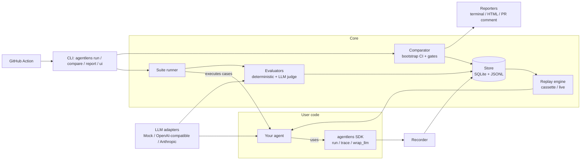

# AgentLens — Architecture

## Overview



## Package layout

```
src/agentlens/
  schema/        # Pydantic models: Trace, Span, Usage, Case, Experiment, EvalResult
  tracing/       # Recorder, context propagation (contextvars), decorators, redaction
  store/         # Store protocol + SQLiteStore, JSONL import/export
  llm/           # LLMClient protocol + adapters (mock, openai_compat, anthropic), pricing
  replay/        # Cassette (record/playback), live replay, divergence detection
  evals/         # Evaluator protocol, deterministic evaluators, judges, registry
  suite/         # Dataset loading (YAML), runner, experiments, baselines
  compare/       # Per-case diff, aggregate stats, bootstrap, gates
  report/        # Terminal (rich), HTML (Jinja2), Markdown (PR comment)
  integrations/  # pytest plugin, (optional) OpenTelemetry exporter, framework hooks
  cli.py         # Typer CLI entrypoint
examples/
  support_agent/ # Demo tool-using agent + golden dataset + regression story
```

## Key design decisions
See `docs/adr/`. Summary:

| ADR | Decision |
|---|---|
| 0001 | Python + uv + ruff + mypy + pytest |
| 0002 | Own thin `LLMClient` protocol instead of LiteLLM/LangChain dependency |
| 0003 | SQLite as default store, JSONL as interchange format |
| 0004 | Cassette-style replay keyed by call order + request hash |
| 0005 | Bootstrap confidence intervals for regression detection |

## Data flow: a CI regression check

1. PR opened → GitHub Action runs `agentlens run suites/support.yaml --name pr-123`.
2. Runner loads dataset, runs agent per case × N repetitions; SDK records traces into the store.
3. Evaluators score each trace (deterministic first, judges only if needed, judge results cached).
4. `agentlens compare --baseline main --candidate pr-123 --gates gates.yaml`.
5. Comparator computes per-metric deltas + bootstrap CI, evaluates gates.
6. Markdown reporter posts PR comment; exit code 1 if a gate fails.

## Extension points
- `Evaluator` protocol / `@evaluator` decorator.
- `LLMClient` protocol for new providers.
- `Store` protocol for other backends (e.g. Postgres) later.
- Framework integrations wrap LangChain/LlamaIndex/OpenAI Agents SDK callbacks into spans.
