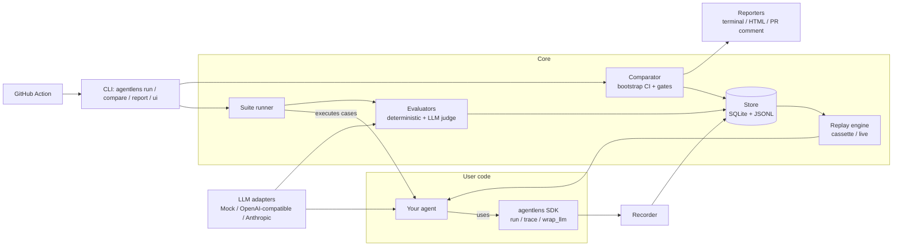

# AgentLens — Architecture

## Overview



## Package layout

```
src/agentlens/
  schema/        # Pydantic models: Trace, Span, Usage, Case, Experiment, EvalResult
  tracing/       # Recorder, context propagation (contextvars), decorators, redaction
  store/         # Store protocol + SQLiteStore, JSONL import/export
  llm/           # LLMClient protocol + adapters (mock, openai_compat, anthropic), pricing
  replay/        # Cassette (record/playback), live replay, divergence detection
  evals/         # Evaluator protocol, deterministic evaluators, judges, registry
  suite/         # Dataset loading (YAML), runner, experiments, baselines
  compare/       # Per-case diff, aggregate stats, bootstrap, gates
  report/        # Report models + renderers: plain text, rich terminal, JSON, Markdown, HTML (Jinja2 templates)
  integrations/  # pytest plugin, GitHub PR comments, (optional) OpenTelemetry exporter, framework hooks
  cli/           # Typer CLI entrypoint (`agentlens`): run, compare, report, baseline, traces, github, ui, ...
  ui/            # Local read-only web UI (`agentlens ui`): stdlib HTTP server, pages reuse report/ templates + JSON API
examples/
  ci_demo/       # Tiny deterministic MockLLM agent + suite + gates run by this repo's CI
  support_agent/ # Demo tool-using agent + golden dataset + regression story
action.yml       # Composite GitHub Action: baseline vs PR run, PR comment, gate exit code
```

## Key design decisions
See `docs/adr/`. Summary:

| ADR | Decision |
|---|---|
| 0001 | Python + uv + ruff + mypy + pytest |
| 0002 | Own thin `LLMClient` protocol instead of LiteLLM/LangChain dependency |
| 0003 | SQLite as default store, JSONL as interchange format |
| 0004 | Cassette-style replay keyed by call order + request hash |
| 0005 | Bootstrap confidence intervals for regression detection |
| 0006 | CI baseline: re-run the suite on the PR's base commit in the same job |

## Data flow: a CI regression check

1. PR opened → the GitHub Action (`action.yml`) checks out the PR's base commit in a temporary
   worktree and runs `agentlens run suites/support.yaml --name baseline-<sha>` there (ADR 0006;
   alternatively a stored baseline restored from a cache), then
   `agentlens run suites/support.yaml --name pr-123` on the PR.
2. Runner loads dataset, runs agent per case × N repetitions; SDK records traces into the store.
3. Evaluators score each trace (deterministic first, judges only if needed, judge results cached).
4. `agentlens compare --baseline baseline-<sha> --candidate pr-123 --gates gates.yaml --json r.json`.
5. Comparator computes per-metric deltas + bootstrap CI, evaluates gates.
6. `agentlens report r.json --format markdown` → `agentlens github comment` creates or updates the
   PR comment carrying the `<!-- agentlens-report -->` marker; then the job exits 1 if a gate
   failed.

## Extension points
- `Evaluator` protocol / `@evaluator` decorator.
- `LLMClient` protocol for new providers.
- `Store` protocol for other backends (e.g. Postgres) later.
- Framework integrations wrap LangChain/LlamaIndex/OpenAI Agents SDK callbacks into spans.
