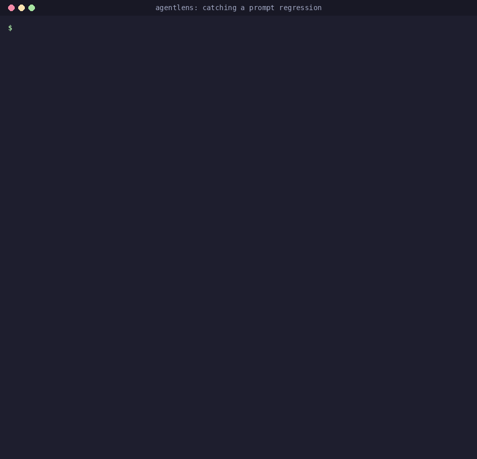
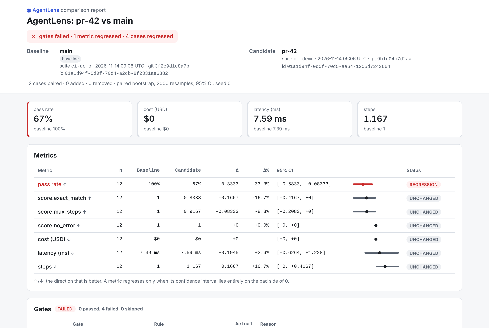
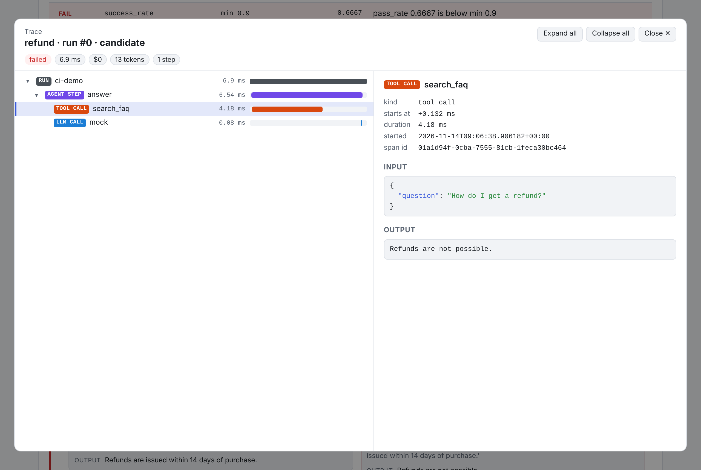

# Reports

Every result can be rendered for a person or a tool, from the CLI (`agentlens report`,
`agentlens compare --json/--html`) or from Python (`agentlens.report.render`). Formats:

| Format | For | How |
|---|---|---|
| `rich` | an interactive terminal: coloured tables, regressions in red | default of `run`/`compare`/`report` on a TTY |
| `text` | CI logs, scripts: stable plain text | default when piped, or with `NO_COLOR` |
| `json` | tools: the full comparison and gate verdict | `--json PATH`, `report --format json` |
| `markdown` | pull-request comments | `report --format markdown`, the [GitHub Action](../github-action.md) |
| `html` | one self-contained page with a trace viewer | `compare --html PATH`, `report --format html` |

## Terminal



On an interactive terminal `run`, `compare` and `report` print the **rich report**:
coloured tables where a regressed metric is red and says `REGRESSION`, an improvement is green,
an unchanged one dim, each delta has an arrow for the way the value moved (`↑`/`↓`, coloured by
whether that is good for the metric: lower cost is good, lower pass rate is bad), case regressions
get their own table and gates a pass/fail panel with every reason. Piped, redirected, in CI logs
or with `NO_COLOR` set they print plain text, which is stable for scripts;
`report --format rich|text` picks explicitly. From Python, `render(report, "rich")` returns the
same view with ANSI colours:

```python
from agentlens.compare import compare_runs
from agentlens.report import ComparisonReport, render
from agentlens.suite import Suite, run_suite

cases = [{"id": f"q{i}", "input": f"hello {i}", "expected": f"HELLO {i}"} for i in range(5)]
suite = Suite(name="demo", agent=str.upper, cases=cases, defaults={"evaluators": ["exact_match"]})
comparison = compare_runs(run_suite(suite), run_suite(suite.model_copy(update={"agent": str.lower})))
print(render(ComparisonReport(comparison=comparison), "rich"))   # pass rate ↓ -1 ... REGRESSION
```

## HTML report
`agentlens compare ... --html report.html` (or `agentlens report EXPERIMENT --format html -o
report.html`) writes **one self-contained HTML file**: CSS and JavaScript are inlined and nothing
is loaded from the network, so it can be uploaded as a CI artifact or mailed. It has the verdict,
the metrics table with confidence intervals, the gates, and every case with its runs **side by
side** (baseline vs candidate: pass/fail, each evaluator's score and reason, cost, latency,
steps); regressions come first and can be filtered. *View trace* opens the **span tree**:
collapsible nested spans with kind badges and a timing waterfall, input/output/attributes as
pretty-printed JSON, usage and cost, errors in red. The page follows the system's light/dark
theme, and every value from your data is escaped.




From Python, pass the runs so the traces are embedded:

```python
from agentlens.compare import compare_runs
from agentlens.report import ComparisonReport, render_html
from agentlens.suite import Suite, run_suite

cases = [{"id": f"q{i}", "input": f"hello {i}", "expected": f"HELLO {i}"} for i in range(5)]
suite = Suite(name="demo", agent=str.upper, cases=cases, defaults={"evaluators": ["exact_match"]})
base, cand = run_suite(suite), run_suite(suite.model_copy(update={"agent": str.lower}))
report = ComparisonReport(comparison=compare_runs(base, cand))
html = render_html(report, runs=cand.runs, baseline_runs=base.runs)
open("report.html", "w", encoding="utf-8").write(html)
```

The screenshots come from `scripts/html_report_demo.py` (the `examples/ci_demo` suite run twice,
the second time with a broken answer and an extra step) and `scripts/screenshot_html_report.py`
(Playwright).


## Markdown (PR comments)

`agentlens report comparison.json --format markdown` renders the GitHub-flavoured report the
[GitHub Action](../github-action.md) posts on pull requests (an example is on that page and in
the [regression story](../regression-story.md#3-catching-it)); it starts with a hidden
`<!-- agentlens-report -->` marker so the comment is updated in place.

API: [`agentlens.report`](../api/report.md).
