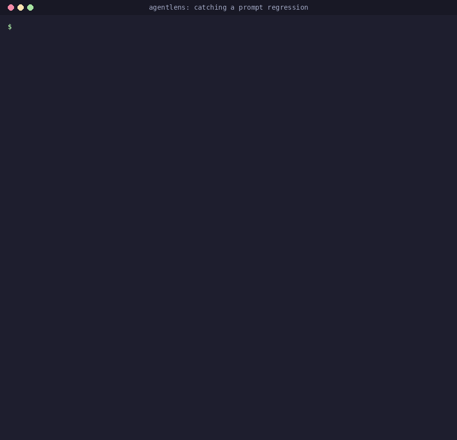

# Getting started

## Install

AgentLens needs Python 3.11+. It is not on PyPI yet (v0.1.0 is next), so install it from source:

=== "uv"

    ```bash
    git clone https://github.com/ggbifulco/agentlens.git
    cd agentlens
    uv sync                        # creates .venv with agentlens and the dev tools
    ```

    Prefix the commands below with `uv run` (as shown), or activate the environment with
    `source .venv/bin/activate` and drop it.

=== "pip"

    ```bash
    git clone https://github.com/ggbifulco/agentlens.git
    cd agentlens
    python -m venv .venv && source .venv/bin/activate    # Windows: .venv\Scripts\activate
    pip install -e .
    ```

    Drop the `uv run` prefix from the commands below.

To use it in your own project instead: `pip install agentlens-toolkit` once it is released on PyPI,
or `pip install "agentlens-toolkit @ git+https://github.com/ggbifulco/agentlens"` until then (add
`[otel]` for the [OpenTelemetry exporter](opentelemetry.md)). The distribution is called
`agentlens-toolkit` because `agentlens` is taken on PyPI; you still `import agentlens`.

## Quickstart: catch a regression in four commands

Everything runs **offline**: the example [support-desk agent](https://github.com/ggbifulco/agentlens/tree/main/examples/support_agent)
uses a scripted mock model, so there is no API key to set and the numbers are the same on every
machine. From the repository root:

```bash
# 1. Baseline: the reviewed prompt on the 27-case golden dataset, marked as the suite's baseline
uv run agentlens run examples/support_agent/suite.yaml --name main --set-baseline

# 2. Candidate: a "simplified" prompt that quietly drops the $200 refund limit
SUPPORT_PROMPT_VERSION=v2 uv run agentlens run examples/support_agent/suite.yaml --name prompt-v2

# 3. Compare with confidence intervals and quality gates; exits with 1 because a gate failed
uv run agentlens compare --candidate prompt-v2 --gates examples/support_agent/gates.yaml --html report.html

# 4. Open the self-contained HTML report
open report.html                   # Linux: xdg-open report.html · Windows: start report.html
```



What happened:

1. `agentlens run` ran every case, recorded each run as a [trace](concepts/tracing.md) (LLM calls,
   tool calls, latency, cost), scored it with the suite's [evaluators](concepts/evaluators.md)
   and saved an *experiment* in `.agentlens/agentlens.db`. The baseline passes 27/27.
2. With the v2 prompt, 25/27 pass: the agent now refunds an $899 laptop instead of escalating it.
   The answer still reads fine; the **trajectory** is wrong (`issue_refund` is a forbidden tool
   for that case).
3. `agentlens compare` paired the two experiments case by case, computed every metric's change
   with a bootstrap confidence interval, listed the two **case regressions** and checked
   [`gates.yaml`](https://github.com/ggbifulco/agentlens/blob/main/examples/support_agent/gates.yaml):
   `case_regressions: {max: 0}` fails, so the exit code is `1` and a CI job would go red.
4. The [HTML report](concepts/reports.md#html-report) shows every case side by side, regressions
   first, with a span-tree viewer for each trace.

Then try `uv run agentlens ui` to browse the same database in the [web UI](web-ui.md), and read the
[regression story](regression-story.md) for the full walkthrough, including the CI side.

## Test your own agent

Any Python callable that takes the case input works as an agent. Wrap its LLM client and tools so
the runs are traced:

```python
# echo_agent.py
import agentlens
from agentlens.llm import LLMRequest, Message, get_client

def run(question: str, model: str | None = None) -> str:
    llm = agentlens.wrap_llm(get_client(model or "mock"))   # "mock" echoes the question
    return llm.complete(LLMRequest(messages=[Message.user(question)])).content
```

Describe the cases and how to score them in a suite, and what "good enough" means in a gates file:

```yaml
# suites/echo.yaml
name: echo
agent: echo_agent:run
repetitions: 3
defaults:
  evaluators: [no_error, exact_match]
cases:
  - {id: hi, input: "hi", expected: "hi"}
  - {id: bye, input: "bye", expected: "bye"}
```

```yaml
# gates.yaml
success_rate: {min: 0.9}          # at least 90% of the runs pass
case_regressions: {max: 0}        # no case that passed on the baseline may fail now
```

```bash
uv run agentlens run suites/echo.yaml --name main --set-baseline
# ... change your prompt, model or code ...
uv run agentlens run suites/echo.yaml --name my-change     # --model openai:gpt-4o-mini: a real model
uv run agentlens compare --candidate my-change --gates gates.yaml
```

`--model` (or `$AGENTLENS_MODEL`) picks the model under test: `mock`, `openai:...`,
`anthropic:...`, `ollama:...` and other [providers](concepts/llm-clients.md); real providers read
their API key from the environment.

## Next steps

- In CI: the [GitHub Action](github-action.md) runs the suite on the PR's base commit and on the
  PR, posts the comparison as a PR comment and fails the job when a gate fails.
- Next to your tests: the [pytest plugin](pytest-plugin.md) turns each case into a test.
- Scoring: [built-in and custom evaluators](concepts/evaluators.md),
  [LLM judges](concepts/judges.md) (and [how far to trust them](judges.md)).
- Deterministic re-runs without API calls: [replay cassettes](concepts/replay.md).
- Every command and option: the [CLI reference](cli.md).
