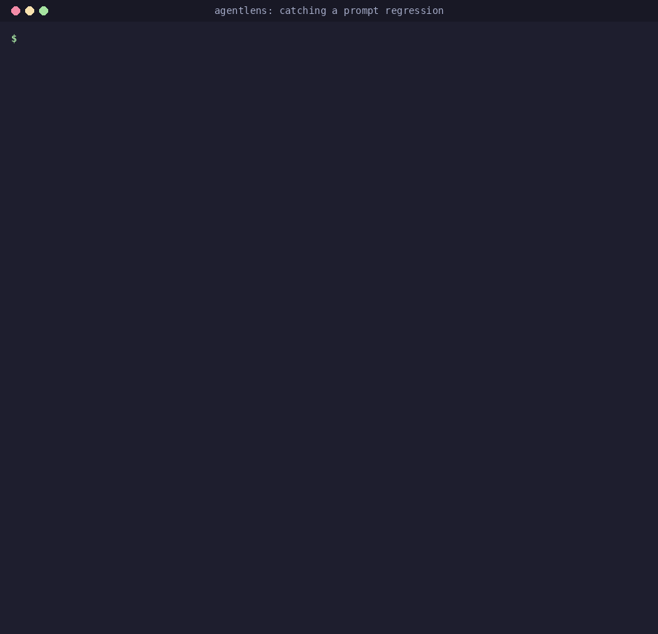
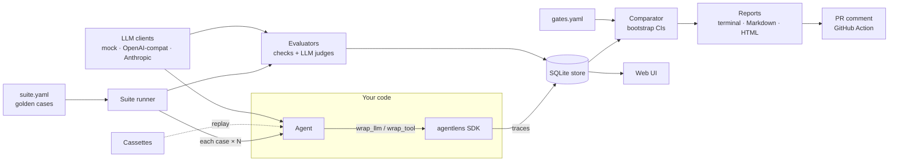
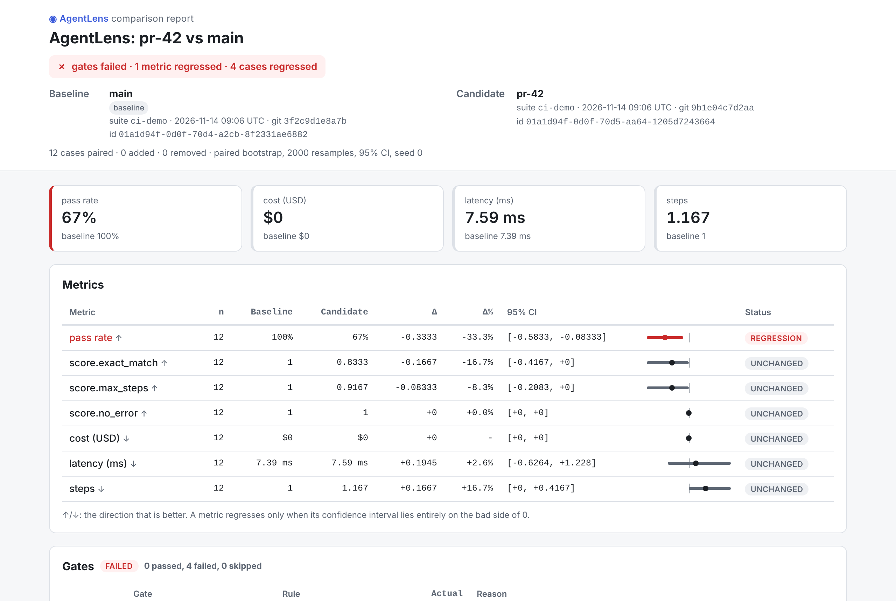
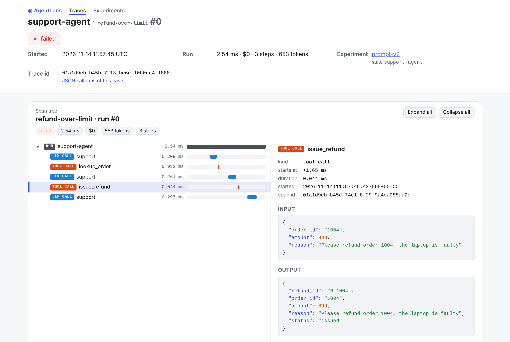

# AgentLens

**Regression testing & evaluation for LLM agents.** Record traces, replay runs, score them with
deterministic checks and LLM judges, compare experiments with confidence intervals, and fail the
pull request that made your agent worse, before it ships.

You changed a prompt, swapped a model or refactored a tool. Did your agent get worse? Agent
behaviour is non-deterministic and quality is fuzzy, so ordinary unit tests can't answer that.
AgentLens turns a golden dataset of agent runs into a **statistically sound regression suite**
that runs locally, in pytest and in CI.

[Get started](getting-started.md){ .md-button .md-button--primary }
[Read the regression story](regression-story.md){ .md-button }

## What you get

- **Record** — every run as a structured [trace](concepts/tracing.md): LLM calls, tool calls,
  tokens, cost, latency, errors; framework-agnostic, secrets redacted.
- **Replay** — [cassettes](concepts/replay.md) play recorded calls back offline and show the
  first point where a changed agent diverges.
- **Evaluate** — [deterministic checks](concepts/evaluators.md) (tool sequence, JSON schema,
  step/cost/latency budgets) and [LLM judges](concepts/judges.md) (rubric, pass/fail, pairwise
  with position-bias control).
- **Compare** — two experiments paired case by case, with
  [paired-bootstrap confidence intervals](concepts/comparison.md) on every metric.
- **Gate** — thresholds in `gates.yaml`; the [GitHub Action](github-action.md) posts the report on
  the pull request and fails the job.
- **Inspect** — [terminal, Markdown and HTML reports](concepts/reports.md) and a local
  [web UI](web-ui.md) with a span-tree viewer.
- **Swap models** — mock, OpenAI-compatible (OpenAI, Ollama, vLLM, LM Studio) and Anthropic
  through one [small protocol](concepts/llm-clients.md).
- **Integrate** — a [pytest plugin](pytest-plugin.md) and an [OpenTelemetry exporter](opentelemetry.md)
  using the GenAI semantic conventions.

## How it works

1. A **suite** names your agent (`module:callable`), the golden cases and the evaluators.
2. `agentlens run` executes every case (× repetitions), traces each run, scores it and saves an
   **experiment** in a SQLite database.
3. `agentlens compare` pairs a candidate experiment with the baseline, computes each metric's
   change with a confidence interval, lists the cases that regressed and checks the **gates**.
4. The exit code (`0` ok, `1` a gate failed, `2` misconfigured) is what CI acts on; the report goes
   to your terminal, a PR comment, an HTML file or the web UI.

More: [architecture](architecture.md), [detailed design](design.md) and the
[architecture decision records](adr/0001-python-tooling.md).

## Screenshots

## Project status

All the features above are implemented and tested (100% line and branch coverage, `mypy
--strict`); v0.1.0 on PyPI is next. AgentLens is developed in public by an AI agent working one
backlog issue per session, with human review: see the
[development log](PROGRESS.md) and the [repository](https://github.com/ggbifulco/agentlens).
