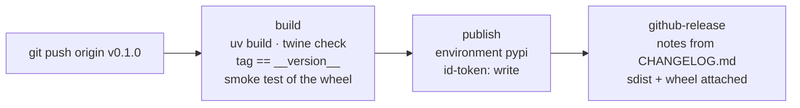

# Releasing

AgentLens is published to [PyPI](https://pypi.org/) by the workflow
[`.github/workflows/release.yml`](https://github.com/ggbifulco/agentlens/blob/main/.github/workflows/release.yml)
when a version tag `vX.Y.Z` is pushed. It uses **trusted publishing**: PyPI trusts this workflow
through OpenID Connect, so there is no API token to create, store or rotate.



!!! note "The distribution is `agentlens-toolkit`"
    <https://pypi.org/project/agentlens/> belongs to an unrelated project, and a trusted publisher
    can only be added to a project you own (or as a *pending* publisher for a name that does not
    exist yet). AgentLens is therefore published as **`agentlens-toolkit`** (maintainer's decision,
    2026-11-14); the import name `agentlens` and the `agentlens` command are unchanged.

## One-time setup

1. **PyPI trusted publisher.** Sign in to PyPI → *Your account* → *Publishing* → *Add a new
   pending publisher* (for a project that does not exist yet; for an existing project you own:
   project → *Settings* → *Publishing*), *GitHub* tab:

    | Field | Value |
    |---|---|
    | PyPI Project Name | `agentlens-toolkit` |
    | Owner | `ggbifulco` |
    | Repository name | `agentlens` |
    | Workflow name | `release.yml` |
    | Environment name | `pypi` |

2. **GitHub environment.** Repository → *Settings* → *Environments* → *New environment* →
   `pypi`. Recommended: *Required reviewers* (yourself), so every upload waits for a click, and
   *Deployment branches and tags* → *Selected* → tag rule `v*`.

3. **Optional TestPyPI dry run.** Same as step 1 on <https://test.pypi.org> with environment name
   `testpypi`, and a `testpypi` environment on GitHub. Then *Actions* → *Release* → *Run
   workflow* with **testpypi** ticked builds, checks and uploads to TestPyPI without tagging
   (an already uploaded version is skipped: TestPyPI, like PyPI, never accepts the same version
   twice).

Without a tag, *Run workflow* (testpypi unticked) runs only the build job: a release rehearsal
that builds, checks the metadata and smoke-tests the wheel.

## Release steps

1. **Version.** Set `__version__` in `src/agentlens/__init__.py` (the single source of the
   version: `pyproject.toml` reads it through hatchling) following
   [Semantic Versioning](https://semver.org/); `0.x` minors may break the API.
2. **Changelog.** In `CHANGELOG.md`, move the `[Unreleased]` entries under a new
   `## [X.Y.Z] - YYYY-MM-DD` heading (the release date), leave `## [Unreleased]` empty above it,
   and update the compare links at the bottom. The section body becomes the GitHub release notes.
3. **Check locally.**

    ```bash
    python3 scripts/release.py check-tag vX.Y.Z   # tag == __version__, CHANGELOG entry exists
    python3 scripts/release.py notes X.Y.Z        # the release notes
    uv build && uvx twine check --strict dist/*
    ```

4. **Merge** these changes to `main` through a pull request (CI green).
5. **Tag and push** from the merged `main`:

    ```bash
    git checkout main && git pull
    git tag -a vX.Y.Z -m "AgentLens vX.Y.Z"
    git push origin vX.Y.Z
    ```

6. **Approve** the `pypi` deployment in the workflow run (if reviewers are required). The
   workflow publishes the sdist and wheel, then creates the GitHub release *AgentLens vX.Y.Z*
   with the CHANGELOG section as notes and the distributions attached. A draft release prepared
   for the same tag is replaced.
7. **Verify**: `pip install agentlens-toolkit==X.Y.Z` in a fresh environment, `agentlens --version`.

If the build job fails (tag and version differ, missing CHANGELOG section, broken wheel),
nothing has been published: delete the tag (`git push --delete origin vX.Y.Z`,
`git tag -d vX.Y.Z`), fix, and tag again. Once a version is on PyPI it can never be uploaded
again, even after deleting it there: fix forward with `X.Y.Z+1`.
