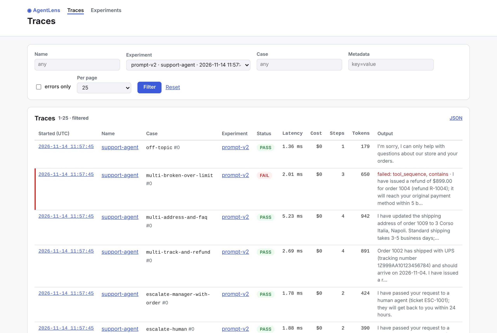
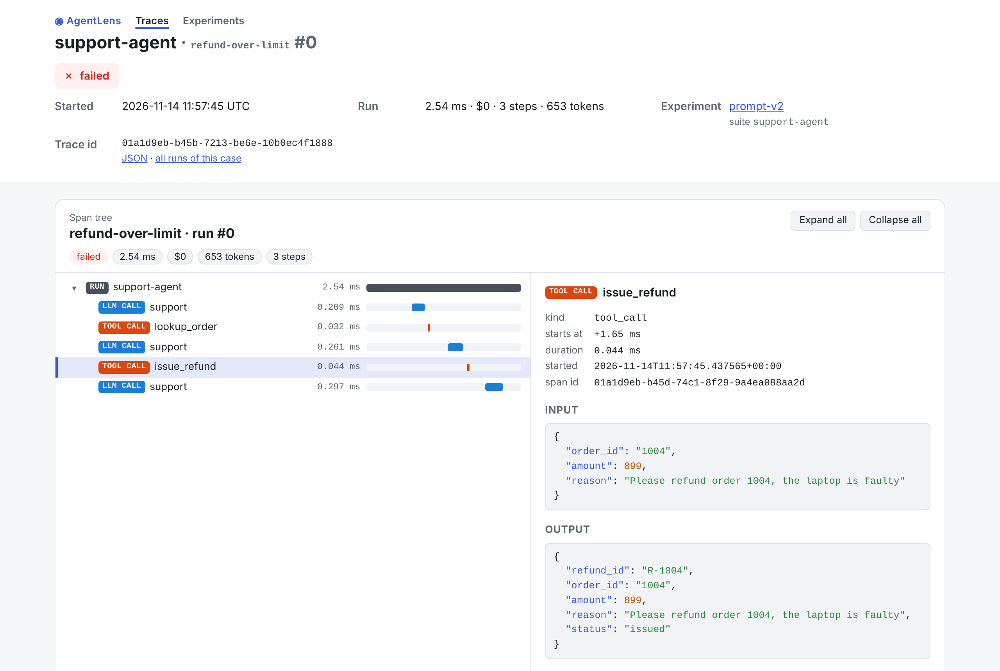

# Web UI

`agentlens ui` serves a small **read-only** web UI over the database on
`http://127.0.0.1:8765/` (and opens it in your browser; `--no-open`, `--port`, `--host`, `--db`):

- **Traces**: filter by name, experiment, case, metadata (`key=value`) or *errors only*, page
  through them; each row shows pass/fail (with the failed evaluators), latency, cost, steps,
  tokens and the output. A trace opens on its **span tree** (the HTML report's viewer).
- **Experiments**: every run of every suite, the baseline marked; pick a baseline and a candidate
  (or *vs baseline*) for the **comparison**: metrics with confidence intervals, gates
  (`agentlens ui --gates gates.yaml`) and every case side by side. An experiment opens on its report.
- **JSON API** with the same data: `/api/traces?experiment=pr-123&errors=1&limit=20`,
  `/api/traces/ID`, `/api/experiments`, `/api/experiments/ID`, `/api/compare?baseline=&candidate=`.

```bash
agentlens run examples/support_agent/suite.yaml --name main --set-baseline
SUPPORT_PROMPT_VERSION=v2 agentlens run examples/support_agent/suite.yaml --name prompt-v2
agentlens ui --gates examples/support_agent/gates.yaml
```




It runs on the standard library's HTTP server (no extra dependency, no JavaScript framework,
nothing loaded from the network), listens on loopback only unless you pass `--host`, answers
only `GET`, and escapes everything it shows. From Python:
`agentlens.ui.serve(agentlens.ui.make_server(agentlens.ui.UIApp("runs.db"), port=0))`.


API: [`agentlens.ui`](api/ui.md).
